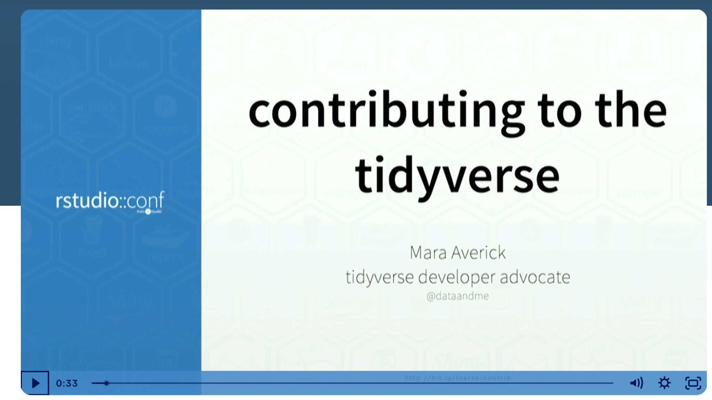
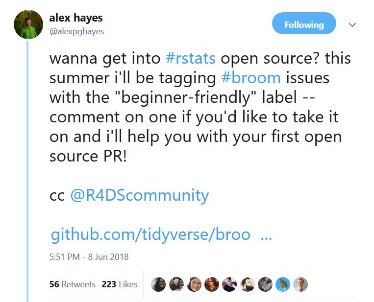
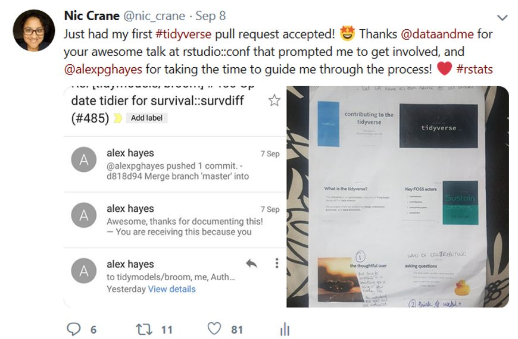
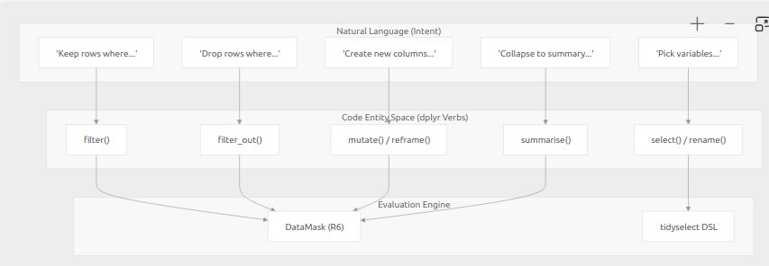
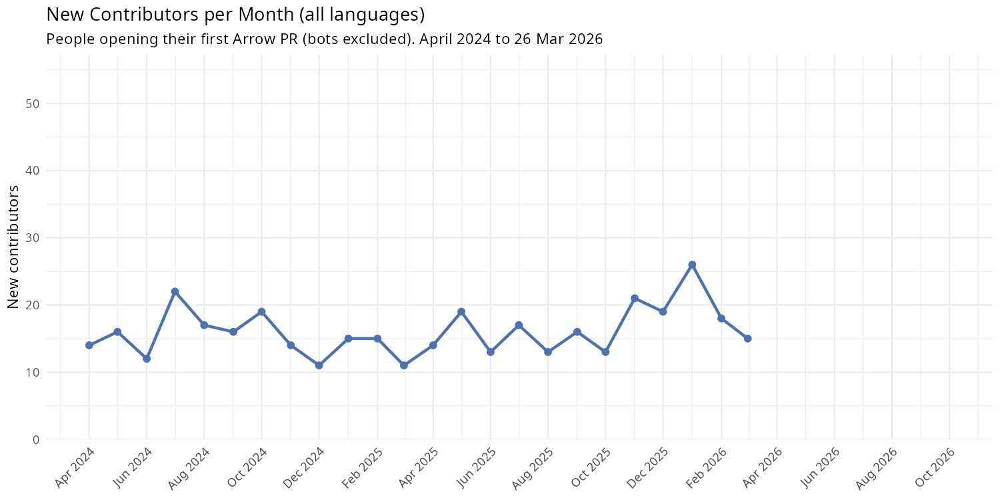
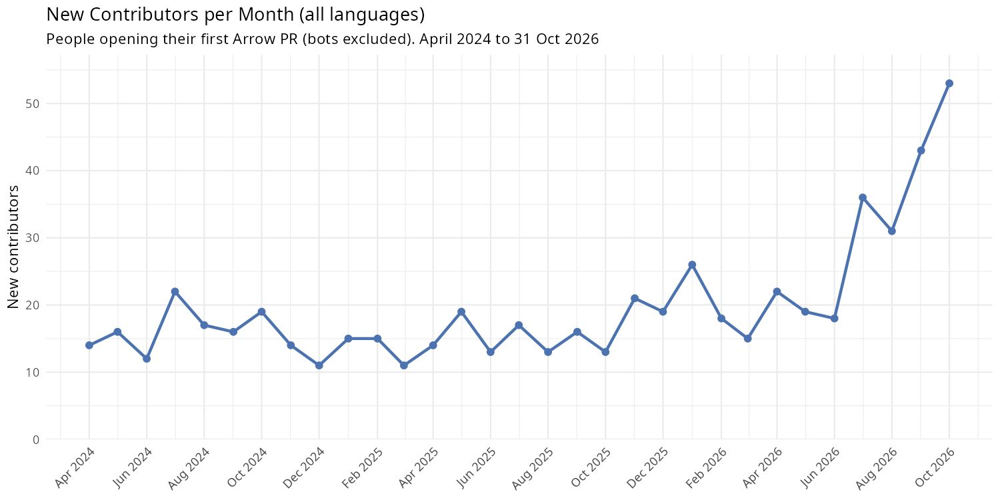
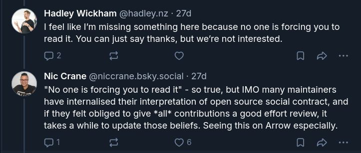
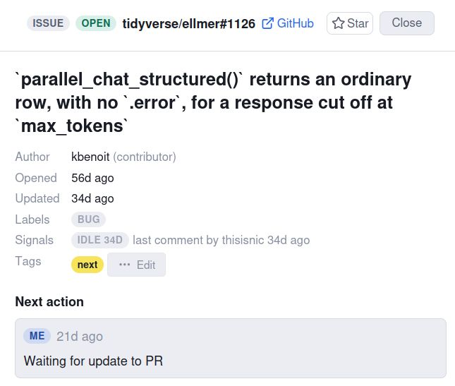

## 2016

::: {.notes}
PhD in psych and stats, learned R, loved coding, heard about data science
:::

## {.center}

{.r-stretch}

::: {.notes}
- "Sexiest job of 21st century"
- Courses online saying need to know - Bayesian modelling, XGBoost, R and Python, SQL optimisation, forecasting, Hadoop, regular expressions... overwhelming
- Made a neurotic list, tried to do lots
:::

## {.center}

{.r-stretch}

::: {.notes}
Here's spreadsheet. Didn't ever fill, gave up and just applied for jobs.
Got one, realised hype, about my capacity to learn and grow while I was doing what I already was doing.
:::

## {.center}

{.r-stretch}

::: {.notes}
- Lots of criticism at time about people searching for "data science unicorn" - 1 person who has the same skillset as you'd expect a whole team of people to have; unrealistic
:::

## 2026

```{r}
#| eval: true
#| echo: false
#| fig-width: 10
#| fig-height: 5
#| fig-align: center
library(ggwordcloud)

hype <- data.frame(
  word = c("agents", "RAG", "vector databases", "prompt engineering", "LLM-as-a-judge",
           "evals", "AI data analyst", "text-to-SQL", "MCP", "embeddings",
           "structured outputs", "fine-tuning", "synthetic data", "tool calling", "vibe coding",
           "agentic workflows", "context engineering", "semantic layer",
           "chat with your data", "LLMOps", "hallucination", "data agents", "harnesses",
           "retrieval", "reranking", "chunking", "knowledge graphs", "GraphRAG",
           "function calling", "few-shot", "chain-of-thought", "reasoning models",
           "guardrails", "red teaming", "prompt injection", "context windows",
           "multimodal", "copilots", "foundation models", "AI code review"),
  weight = c(10, 9, 8, 8, 7, 7, 7, 7, 6, 6, 6, 5, 5, 5, 5, 5, 5, 4, 4, 3, 3, 3, 3,
             4, 3, 3, 3, 3, 4, 3, 3, 4, 3, 2, 3, 3, 3, 3, 3, 3)
)

set.seed(2026)
ggplot(hype, aes(label = word, size = weight, colour = weight)) +
  geom_text_wordcloud(family = "sans", rm_outside = TRUE) +
  scale_size_area(max_size = 22) +
  scale_colour_gradient(low = "#888888", high = "#107895") +
  theme_void()
```

::: {.notes}
- Remind me of ppl talking about AI and AI skills in 2026 - RAG, agents, harnesses, vector databases
- Smells like hype cycle
:::

## AI skill threat

::: {.statement}
"I am deeply afraid that the skills and expectations of my professional identity are changing, and I will not succeed."
:::

<small>Cat Hicks, [AI skill threat and contest cultures on software teams](https://www.drcathicks.com/post/new-research-from-me-ai-skill-threat-contest-cultures-on-software-teams)</small>

::: {.notes}
The problem is that this can help us get in our own way - Cat Hicks talks about AI skill threat, the idea that the expectations of our professional identities and skills are changing and feeling like we're going to fail.

It comes from things like thinking about skills as innate and feeling like you have to prove your skills, and we end up feeling inadequate.

It's even more pronounced in women + gender minorities and other minorities.

But we can counter that if we're part of a learning culture, a culture based around the belief we can learn, grow, develop, and take on new skills.
:::

## {.center}

{.r-stretch}

::: {.notes}
If we do engage with AI, how do we go about doing this? Idea that AI degrades existing skillsets.

Crisis in universities on assessment - don't have an answer.

Fluency illusion, generating code and understanding it.

Favourite depiction is from Wes M at posit::conf, talks about idea by Cory Doctorow.
:::

## {.center}

{.r-stretch}

::: {.notes}
CD is a comp sci writer who talks about the reverse centaur.

Centaur == mythical creature with the head and body of human and back end of horse. Human skills, thinking; horse speed and strength. More than just a human, an enhanced human.

Reverse centaur == head of a horse and legs of person. Useful, can kind of walk around and neigh but the worst of both worlds.

Apply to AI - wanna be centaur, enhanced, not just a crap horse.

Reverse centaur is a human sat there going "yes" without thinking to AI prompts, not thinking or doing anything else or learning anything.
:::

## {.center}

::: {.statement}
how can I use AI so I become more capable, and not dependent?
:::

::: {.notes}
Leads me to question... how can I use AI so I become more capable, and not dependent, but also have some fun when I'm doing it?

So to answer this, I'm going to first talk about using AI for learning, by thinking about what it was like to start working on a new project in R before AI, and then what it was like to get started now that AI is so prevalent, and how I've stopped myself becoming the reverse centaur.
:::

# Learning about code

::: {.placeholder}
IMAGE TO GENERATE. Prompt: "Mid-century retro-futurist magazine illustration, 1950s American style, warm gouache colours, slightly faded print texture. A bright classroom of the future: rows of students at individual desks each with a small glowing TV screen, a friendly robot teacher at a chalkboard covered in code and diagrams, a woman in a red dress at the front desk studying a punch-card manual with a confident smile. Optimistic, clean, atomic-age design. Wide 16:9 composition with uncluttered space in the lower left for a title."
:::

## First open source contribution

::: {.notes}
Now my job but before this, small voluntary contributions.

Working with R since 2010 but took until 2018 until first PR.

Most of us didn't study CS, don't feel like "proper" software engineer but here we are doing things that "proper" software engineers do, but it's easy to feel intimidated which is why it took me so long.
:::

## 2018

{.r-stretch}

<small>posit.co/resources/videos/contributing-to-tidyverse-packages</small>

##

{.r-stretch}

::: {.notes}
rstudio::conf 2018, Mara Averick - how to contribute to the tidyverse: how to make a fork, how to make a PR, what to work on - contribute documentation.

Made first open source contribution in 2018.
:::

## 

{.r-stretch}

::: {.notes}
- Yay exciting
- Did bits occasionally after that but the big thing for me was in 2021 when got apprenticeship learning to be an open source maintainer, so someone who has responsibility for reviewing other people's code and the ongoing health of a project
:::

## {.center}

{.r-stretch}

::: {.notes}
- Project was arrow
- What is arrow?
  - R package is for working with larger than memory data in R
  - Working with Parquet format data
- Open source maintainer apprenticeship - path from zero to contributor to maintainer
  - Never seen arrow code before this
  - Huge project, tens of thousands lines of code and lots of languages
  - R package wraps C++; project includes C++ too
- Tremendous amount of effort to get started
:::

## Learning to maintain Arrow

::: {.placeholder}
PLACEHOLDER IMAGE: visual representation of the complexity of the Arrow codebase. Not made yet. Ideas: a treemap of the repo by language, or a folder map of the R package wrapping C++.
:::

::: {.notes}
- Learning by analogy
- My mentor, Jon Keane, spent lots of time curating a list of different issues for me to work on, other issues to read to help me work out how to solve individual ones, and spent lots of time jumping on calls explaining technical details to me of how things worked and giving advice
- High level view
  - Mapping out folders, areas; reading code slowly; sketching diagrams of how pieces fit together

Only doable working full time, sooo much to learn!

Shallow version of this - learning by analogy:

- My first PR was C++ despite never having written a single line of C++ before, still don't
- Many examples like this: it works but I don't know why
- A bit like copying and pasting code from Stack Overflow, which I'm sure lots of us have done here

We say AI helps us generate code but not understand how it works, but we were already able to do this before AI, just less efficiently!

But things have changed a lot since then...
:::

## {.center}

{.r-stretch}

::: {.notes}
- 2026 - doing some work as a contractor on ellmer
- Package for interacting with LLMs directly from R
- Had written a course on ellmer, found a bug and reported it. Started to fix it but didn't have the time and was complicated and abandoned it.
- When I started working as a maintainer on ellmer, excited to have time to dive into the code properly
- Still social and technical challenges

Complicated codebase!

- Never seen it before
- Working on it part-time
- Bigger jump - from 0 to contributor to maintainer really quickly and much less help!!
  - Contributing code is hard but reviewing other people's code difficult in a different way - answering different questions
- Had AI to help - how I used AI to help
:::

## Learning to maintain ellmer

{.r-stretch}

<!-- Original note: "something like this but less words and more easily
understandable and less distracting" - may want a simplified redraw.
Source: https://deepwiki.com/tidyverse/ellmer/1-overview -->

::: {.notes}
DeepWiki - instead of having to draw out a diagram myself, AI can do it.

And you might recognise this as a thing from dplyr, but how easy was it for AI to do it than it would be for me to take the time.

Back to learning by analogy, I could ask AI what to read and in what order and summarise design decisions.

Now AI can generate me code, but how can I be confident the code I generate is correct?
:::

## Using skills

- Markdown instructions and (optionally) scripts an AI agent can use
- Add consistency - define a process or set of rules to use every time
- Saving human expertise - adding your own knowledge into the process

::: {.notes}
I use skills.

A skill is a set of instructions and scripts an AI agent can use saved in markdown files - and it loads them when it's doing specific tasks.

They're great because they're reusable - you can write down a process and the agent can follow it every time instead of having to guess.

They're useful because they're a way of injecting your own knowledge into the process.

Effectively, a skill is how you turn your own expertise into something the AI can follow.
:::

## Using skills effectively

- Loads of ones written by other people are out there and available
- Include them in code repos - ellmer has one for writing tests
- Write one when it gets the same thing wrong repeatedly

::: {.notes}
Mention the Posit skills repo and their R package development ones: https://github.com/posit-dev/skills
:::

## But how can I trust the code that I generate?

::: {.notes}
Need to be able to review it via actually knowing the codebase itself.

How to do this in a brand new codebase?

Designed a skill to help me do this.
:::

## Five step process

1. **Establish Learning Goals** - define what you want to learn and why
2. **Locate and Access Resources** - identify a minimal set of things to learn from
3. **Adopt and Execute Learning Activities** - design and work through timeboxed, hands-on activities with Socratic support
4. **Monitor and Evaluate Performance** - checkpoints and progress tracking, mostly within step 3
5. **Reassess Learning Strategies** - reflect on what worked and record it for next time

::: {.notes}
Year before, had read a paper by Xi Lin on how people could use LLMs for learning.

Describes how could apply AI to a framework for self-directed learning - this is separate to AI - framework existed, adding AI on top.

So what are the 5 steps in the framework then? Go into what and why (and how LLM can help - the Xi Lin stuff).

Made a Claude skill to help walk me through it.

(Maybe a table with step on left and how AI can help on right?)
:::

## Rapid learning skill

::: {.placeholder}
PLACEHOLDER IMAGE: screenshot of the GitHub repo page for github.com/thisisnic/rapid-learning, showing the README or SKILL.md.
:::

::: {.notes}
Available at this URL.

Let's look through a concrete example of using it for learning...
:::

## Example: how do tool calls work in ellmer?

:::: {.columns}

::: {.column width="45%"}
```r
library(ellmer)
chat <- chat_anthropic()
chat$chat("what's the time")
#> Using model = "claude-sonnet-5".
#> I don't have access to real-time
#> information, so I can't tell you
#> the current time.
```
:::

::: {.column width="55%"}
```r
library(ellmer)
chat <- chat_anthropic()
#> Using model = "claude-sonnet-5".

time_tool <- tool(Sys.time, "Get the time", name = "time")
chat$register_tool(time_tool)

chat$chat("what's the time")
#> ◯ [tool call] time()
#> ● #> "2026-11-01 17:54:46"
#> The current time is **5:54:46 PM** on **November 1, 2026**.
```
:::

::::

::: {.notes}
Tools - give LLMs extra functionality they don't have before.

So if I ask for the time...

So how does this actually work, in ellmer's code?

I know from reading the vignette that the LLM isn't calling the R function. But... how does it get called then?

We're going to use the rapid learning skill to find out! I'm going to show you a slightly truncated version of the process.
:::

## 1. Establish Learning Goals

Ask the user, **one question at a time**:

| Question | My answer |
|---|---|
| What do you want to learn, and why? | How tool calling works in ellmer |
| Where are you starting from? | Written and registered a tool but not looked at the ellmer code before |
| Exactly what are you trying to achieve? | I want to know what ellmer does, like the sequence, and where tool calling fits in |
| How would you like to learn this? | Running code and reading examples |
| How much time do you have? | 20 minutes |

::: {.notes}
Basically, what did the model ask you and why it mattered.
:::

## 1. Establish Learning Goals

::: {.callout-note appearance="simple" icon=false}
**Primary learning goal:** by the end of 20 minutes, be able to describe the sequence of steps ellmer runs during a single chat turn, and say exactly where in that sequence a tool call happens and what triggers it.

**Supporting objectives:**

- Observe a turn with and without a tool call and spot the difference in what comes back from the model
- Locate the loop in ellmer's code that keeps the turn going until the model stops asking for tools
:::

::: {.notes}
Would I have done this if I'd tried learning these things on my own? No!
:::

## 2. Locate and Access Resources

**Outside of the current codebase:** ask questions to figure out what resources are going to be most appropriate

**The current codebase:** don't ask the user anything, find the relevant files yourself

<!-- TODO: fill this in from
https://github.com/thisisnic/rapid-learning/blob/main/SKILL.md#step-2-locate-and-access-resources -->

## 3. Adopt and Execute Learning Activities

- 2-5 hands-on time-boxed activities
- Socratic method - ask the learner questions to help them understand
- Adapt based on responses (if frustrated ask fewer questions!)

::: {.notes}
https://github.com/thisisnic/rapid-learning/blob/main/SKILL.md#step-3-adopt-and-execute-learning-activities

- Socratic method
- Don't forget the stuff you added like getting it to check the time as we go
:::

## 3. Adopt and Execute Learning Activities

Create a chat with one simple tool registered. Ask something that doesn't need the tool, then something that does. After each, look at `chat$get_turns()` and count how many turns one `$chat()` call added, and what role each has.

```r
library(ellmer)
chat <- chat_anthropic()
#> Using model = "claude-sonnet-5".
chat$chat("Say hi!")
#> Hi there! 👋
#>
#> How are you doing today? I'm happy to help with whatever you need...
chat$get_turns()
#> [[1]]
#> <Turn: user>
#> Say hi!
#>
#> [[2]]
#> <Turn: assistant>
#> Hi there! 👋
#> ...
```

::: {.notes}
User took their turn, then the assistant did - this seems straightforward.
:::

## 3. Adopt and Execute Learning Activities

```r
time_tool <- tool(Sys.time, "Get the time", name = "time")
chat$register_tool(time_tool)
chat$chat("what's the time")
#> ◯ [tool call] time()
#> ● #> "2026-11-01 18:07:03"
#> The current time is **6:07:03 PM** on **November 1, 2026**.
chat$get_turns()
#> [[1]]
#> <Turn: user>
#> what's the time
#>
#> [[2]]
#> <Turn: assistant>
#> [tool request (toolu_01CWL6FhPozDU4LNfraEdcbU)]: time()
#>
#> [[3]]
#> <Turn: user>
#> [tool result (toolu_01CWL6FhPozDU4LNfraEdcbU)]: "2026-11-01 18:07:03"
#>
#> [[4]]
#> <Turn: assistant>
#> The current time is **6:07:03 PM** on **November 1, 2026**.
```

::: {.notes}
- Wait a minute, there are more turns here
- [[2]] is an assistant turn - it includes this tool request, a request to use a tool
- But now there's an extra user turn. Now, I, the user didn't ask any other questions, so this must be how ellmer works
- Spoiler - the answer is that ellmer implements these tool calls by running the R function itself, getting the result, and then sending that to the LLM as if the user had sent that information themself.
:::

## Lightbulb moment!

- ellmer calls the tool's function in the R session and sends the results to the LLM as if the user had sent that message!

::: {.notes}
- So when the LLM responds, it has that information.
- But at this point, I only notice there's an extra user turn, and so the agent keeps asking me questions about what I can see here and what I think it does until we switch over to the code to trace it through, and it all makes sense!
:::

## 4. Monitor and Evaluate Performance

- Checkpoint questions - AI asks to make sure crucial ideas are understood
- Congratulate after each completed activity
- Summarise what learned

## 5. Reassess Learning Strategies

- What worked well and what didn't?
- What was the most valuable thing?
- Did you achieve your goals?

Instructions to feed back into the skill.

::: {.notes}
Don't forget to tie this in to the paper and maybe also Simon Couch's stuff too.

Longer session - work through the code itself, didn't include it here.
:::

## What did this give me?

- Huge reduction in overhead planning learning
- Take on more ambitious tasks
- More confidence in my learning

::: {.notes}
Can it be wrong? Yes, sometimes, but rarely when using latest models. And point is you keep asking questions and look things up yourself.
:::

## {.center}

::: {.statement}
Use AI to customise learning to make it work for you
:::

::: {.notes}
Also Cat Hicks - learning opportunities (read about how it works to mention here!)

Cat Hicks: after you complete significant work (which you can self-define, but I've suggested: creating new files or modules, database schema changes, architectural decisions or refactors, implementing unfamiliar patterns, any work where the user asked "why" questions during development. The key idea is to find a moment in your personal flow where a learning opportunity is most beneficial) Claude will ask: "Would you like to do a quick learning exercise on [topic]? About 10-15 minutes."

So another thing that I learned when I was developing the rapid learning skill was how AI made it really easy to play around with an idea and develop it further into something useful, and that's what I'm gonna talk about next.
:::

# Learning through experimentation

::: {.placeholder}
IMAGE TO GENERATE. Prompt: "Mid-century retro-futurist magazine illustration, 1950s American style, warm gouache colours, slightly faded print texture. A laboratory of the future: a woman in a red dress standing at a wall-sized control console covered in dials, reel-to-reel tapes and blinking lights, a tall silver robot beside her pointing at a glowing chart on a screen showing a jagged line going up. Through a large window, a star field and a ringed planet. Optimistic, clean, atomic-age design. Wide 16:9 composition with uncluttered space in the lower left for a title."
:::

::: {.notes}
- March 2026
- Company who had funded most of the work on Arrow - Voltron Data - had folded and so fewer paid maintainers, but some of us who were left had managed to get some funding to work on maintaining the project
- Was doing lots of maintenance, but was unsure whether what I was doing was actually useful
:::

## A question

::: {.statement}
"What can I work on that I can be sure is having an impact?"
:::

<small>March 2026 with Positron Assistant, using Claude Sonnet 4.6 and Claude Opus 4.5</small>

::: {.notes}
- Decided to think about the new contributor experience - how easy is it for people to get started with contributing to arrow and has the new contributor experience got worse since we've had fewer maintainers?
- Experimenting with Positron Assistant to produce a Quarto markdown report with plots that I could add narrative to
- Started by asking "can you create an R script showing number of new contributors per month"
:::

## How has the number of active contributors changed?

{.r-stretch}

::: {.notes}
First question - how have the changes in Voltron Data existing as a company impacted the number of people contributing to Arrow?

Active contributors - people who've opened an issue or a PR in past 90 days.

As expected - declined due to corporate layoffs but then flattened out and stabilised more recently after we got some funding for its maintenance.

Next question then - how many new contributors per month?
:::

## A new metric...

{.r-stretch}

::: {.notes}
- A few each month
- Huge spike in January 2026 - likely from AI generated PRs
- But the number of new contributors might not be the best metric... how many were successful, how many got PRs merged?
:::

## Wait... whut?!

{.r-stretch}

::: {.notes}
- And we got this!
- Oh no, we never merge PRs from new contributors :(
- And it gets even worse as I check out the narrative that Claude has added to it
:::

## A poor experience for newcomers?

> "These PRs are sitting entirely unacknowledged, which is both a poor contributor experience and a growing triage burden for maintainers."

> "Some are substantive pieces of work (look at <list of PRs>) that just didn't make it through."

(sad face)

## A poor experience for newcomers? Not quite

> "These PRs are sitting entirely unacknowledged, which is both a poor contributor experience and a growing triage burden for maintainers."

- Me: "don't add judgemental comments about poor contributor experience please, just report the facts."

> "Some are substantive pieces of work (look at <list of PRs>) that just didn't make it through."

- Me: "hmm... how do you know? These were opened within 3 mins of each other..."

::: {.notes}
Scepticism -> think more about the "nothing merged" and then remembered - every time we do a release, we post on social media thanking people!
:::

## A revelation

{.r-stretch}

::: {.notes}
- Looks like this! So clearly we do have new contributors
- And then I started arguing with AI - told it it was wrong 5 times, and told it to use the script we actually use to generate this list
- Difference - git history vs. GitHub field
- Problem - when we merge things into the project we use a script that can make them appear as closed on GitHub and not merged! So the plot was wrong
- And we decided to make a new one, this time showing the proportions of PRs closed without merging, merged, and never reviewed
:::

## What happens to new contributors' PRs?

{.r-stretch}

::: {.notes}
- Got this! Much more useful!
- Blue - ones which did get merged, so looks reasonable
- Orange - closed without merging - sometimes the author gives up, sometimes the issue turns out to be something else
- Grey - hadn't been reviewed yet
  - Higher proportions more recently, that makes sense - maintainers working through the backlog
  - But... wanted to know more and dig deeper into this!
:::

## New categorisation scheme

- "There was a comment in the past 3 weeks"
  - New category: "active"
- "Last comment was from maintainer over 3 months ago with no response from author"
  - New category: "abandoned"
- "Last comment by the author and over 3 weeks ago"
  - New category: "stale-risk"

::: {.notes}
Ended up with a series of classifications...
:::

## Back to my original question

### What can I work on that I can be sure is having an impact?

- Find stale PRs and ping the maintainers for an answer, or answer the question to check if they're still working on them
- Find abandoned PRs and
  - finish them off if they're close to completion, or
  - close them if not so someone else can work on them (added a bot to close them)

::: {.notes}
- Ended up with concrete outcomes here
- Questions shifted from "how can I help new contributors" to "how can I help the project get more issues resolved"
:::

## What I learned

- Wrong answers were still useful
- Fast iteration made me realise I was asking the wrong question
- Domain knowledge and scepticism did the hard work

::: {.notes}
- Even wrong answers were useful
  - Even though the analyses were crap/misleading, I learned a lot by arguing with AI, verifying and checking things, and expanding on it when it was correct
    - None of the earlier plots made it into the final report but they helped me work out what to ask
  - I had a dashboard showing new contributions and I updated it to use the new definition of new contributor (i.e. the human-generated one was wrong too, the AI made the same mistakes!)
  - I learned a lot about our data from doing this!
- Being able to generate plots so quickly made it possible to figure out I'd been asking the wrong question all along
  - Shifted from "how can we help new contributors" to "how can we help get code merged into the project and reduce maintainer burden"
- Understanding the domain not the data was crucial for figuring out what was wrong and why. Manually checking the results was essential. Extreme scepticism was essential - treat outputs as hypotheses not answers.
- It took ages! Experimentation isn't efficient but you learn a lot. As a human I might have decided the metrics and then built them, but this allowed me to try a huge mix of things.
- Experimentation taught me the right question to ask but my expertise told me which answers to trust
:::

## {.center}

::: {.statement}
Use AI to run experiments cheaply and learn about your reality
:::

# Adapting how you work

::: {.placeholder}
IMAGE TO GENERATE. Prompt: "Mid-century retro-futurist magazine illustration, 1950s American style, warm gouache colours, slightly faded print texture. The office of the future: a woman in a red dress relaxing in a bubble chair with a cup of tea, feet up, while a row of small cheerful robots do the filing and sort stacks of paper into pneumatic tubes. Monorails and flying cars pass by a huge curved window with a sunny city skyline. Optimistic, clean, atomic-age design. Wide 16:9 composition with uncluttered space in the lower left for a title."
:::

::: {.notes}
- Last piece of puzzle is about thinking about how we work
- Adapt how you work with AI so you don't end up fighting it or getting overwhelmed
- Those plots I shared before that showed a small blip in the new contributors?
:::

## 

{.r-stretch}

::: {.notes}
- This one was generated in March 2026. Steady decline, flattening at the end.
- Looks like a fairly consistent pattern, even with AI becoming more prevalent, everything's under control, right?
:::

## 

{.r-stretch}

::: {.notes}
Wrong. Regenerated this a couple of weeks ago.

What I think happened: models got good enough, people realised they can contribute with agents, and they are.

It's a mix. Genuine: people who never thought they could contribute, now can. Great. Less good: code dumped that the author doesn't understand. Review feedback goes straight back into the AI. Maintainer burns hours. The person never comes back. Nobody learned anything.

Hard: welcome the first group without spending all our time on the second.

Mindset shift. Before, every PR got my full attention. Now that's draining.
:::

## Carrying on as-is

Consequences:

- See the results of the AI report you wrote
- Stress
- Arguing with other maintainers (the you and kou thing)
- Also, think about on ellmer - for you, both writing code and reviewing others'
  - Cognitive load
  - All the caffeine
  - The guilt!
  - Being meticulous and people just putting stuff back into AI (i.e. no pushback on reviews, make it transactional not social)

## Initial attempt to sort it out

- Written rules
- Did it do anything?
- Disclosure form
  - No, but could see who deleted it and who didn't
- Stuff from the report here, but the human side of it

## Trying to change

- How can I keep up?

## How do air traffic controllers maintain concentration?

{.r-stretch}

::: {.notes}
- First instinct: how do people whose whole job is sustained concentration do it?
- Mandatory breaks every 1.5 to 2 hours, minimum rest between shifts, standard ways of communicating.
- But hold up, this is crazy!
- So I tried it. Reviewing in the morning, other work in the afternoon. Little bits at a time.
:::

## 

{.r-stretch}

::: {.notes}
Could go further and reduce the number of decisions to make. Zuckerberg's t-shirts: fewer decisions in the day.
:::

## Not becoming the reverse centaur

- AI doing the first round of reviews
- Auto-closing stuff

## 

{.r-stretch}

## Set boundaries!!!

::: {.statement}
"How does \<prominent maintainer\> say no?"
:::

::: {.notes}
(Watch video for Blythe's saying no bit.)

- Stop working when I'm too tired to think and go for a walk or get a cup of tea
- Intentionally slow down on some tasks
- Set good boundaries, and refuse to respond to AI-heavy walls of text or output where there's no "proof of life"
- Started feeling guilty about needing to say no so much, when some people have put time and effort into PRs, which led to my question where I asked AI "how does Hadley say no" and it summarised it by saying you should treat a PR like a proposal not a gift, so like a friend suggesting you go to a concert by an artist you don't know if you like, and not a sweater 3 sizes too big and not in your colour that a distant relative gifts you for Xmas
  - Engage with humans more
- Stopped trying to get things done faster, remain in control

Point was - started off thinking I was the one needing to change, and that's when you become the reverse centaur.

Figure out what works for you and update your workflows, not how you can change for it. Key was - I was trying to work harder but I needed to work differently.

---

3. Boundaries. With myself first: too tired to think -> tea, walk. Intentionally slow down on some tasks. Stop trying to go faster.

- With others: AI wall-of-text issue -> I don't read it. Get a summary, or "can you explain this in your own words?"
- Social fatigue: felt guilty saying no so much. A PR is someone's effort. My instinct is to welcome them.
- So I did the section-2 thing on my own problem. Got AI to read closed tidyverse PRs: how do Jenny and Hadley say no?
- Answer: thank them, explain why. But mostly: treat a PR as a **proposal, not a gift**. A friend saying "gig tonight?", not grandma's beige sweater, three sizes too big.
- I started off thinking I was the one who had to change. That's the reverse centaur. What had to change was outside me: workflows, boundaries, what I say yes to.
- I was trying to work harder. I needed to work differently.
:::

## What does setting good boundaries look like?

- You are allowed to say "no" without long justifications
- Focus on your own actions not theirs
- "If \<X\> then \<Y\>"

## What does setting good boundaries look like?

**You are allowed to say "no" without long justifications**

- I'm not going to spend time reviewing long AI-generated pull requests from new contributors

**Focus on your own actions not theirs**

- I can't stop people submitting AI-generated pull requests but I can refuse to engage with them

**"If \<X\> then \<Y\>"**

- If a pull request hasn't been reviewed by a human before they submit it, I'm going to close it without review

## (blank)

## Previous stuff...

## AI generated code

::: {.notes}
Why is it hard to review AI-generated code?

Other people's code

- Used to be signals, gut feelings, certain mistakes gave signals

Own code

- Why has it made that decision?
- Is this code fitting with the rest of the codebase?

Other problem is properly reviewing AI-generated code - both my own and others

- Used to be signals as to how advanced a person was or not but those are different
- Decision fatigue
- Found it hard to work for as long as I used to

Not just me...

- Why is reviewing AI code so hard?
- Other people's code used to come with signals. Gut feelings. The kind of mistake someone makes tells you what they understand and what to teach them. Now the only thing the code tells you is which model wrote it.
- Reviewing is harder than writing. And now it's all reviewing.
- What it did to me: cognitive overload, decision fatigue, couldn't work as long as I used to.
- And it's not just me...
:::

## "AI Doesn't Reduce Work - It Intensifies It"

> "worked at a faster pace, took on a broader scope of tasks, and extended work into more hours of the day"

<small>[hbr.org/2026/02/ai-doesnt-reduce-work-it-intensifies-it](https://hbr.org/2026/02/ai-doesnt-reduce-work-it-intensifies-it)</small>

::: {.notes}
- HBR, earlier this year. People using AI worked faster, took on a broader scope, and extended work into more hours of the day.
- Doesn't feel like it's helping anybody.
:::

## But wait... very reverse centaury!

::: {.notes}
- Hold on. This tool is supposed to help me. And here I am rearranging myself around it.
- That's the reverse centaur.
- So: pause. What are the more sustainable, actually human ways out of this?
:::

## Get AI to do first pass -> improve own process

::: {.notes}
Getting AI to do the boring bits

- Figure out what small tasks you can automate and do it. Even if it's just summaries or things for you to review.
  - Initial AI review
- Teaching AI how to do good code reviews
  - Defining what does good look like and getting AI to help with it - i.e. made me define process for PR review - doing this made me reflect on what good looked like and my non-AI code review got better
- Getting AI to walk through chunk of changes at a time

1. Get AI to do the boring bits. Find small tasks to automate: a summary of what needs doing, a first-pass review.

- Teaching it to review meant writing down my own process. I had to decide what good looks like.
- Result: my non-AI reviews got better too. I know my own process now.
- Generated code: walk me through a chunk at a time, not everything at once.
:::

## 

{.r-stretch}

::: {.notes}
Decision fatigue is huge thing! Vibe coded a thing to track decisions: repotracker tool to track decisions I've made.

2. Decision fatigue. The open PR list makes you make the same decisions every day. What should I review? What am I waiting on?

- Vibe-coded a tracker. Notes to myself, not to the contributor. Decide once.
:::

## {.center}

::: {.statement}
Change your workflow, not yourself
:::

## How can we use AI to make us more capable and not more dependent?

3 things:

1. Use it to completely customise your learning in a way that works for you
2. Use it to experiment cheaply, learn about your own reality
3. Adapt how you work - change your workflows not yourself

::: {.notes}
How can we use AI to make us more capable and not more dependent? 3 things:

1. Use it to completely customise your learning in a way that works for you **and you keep the knowledge**
2. Use it to experiment cheaply, learn about your own reality **and you keep the judgment**
3. Adapt how you work - change your workflows not yourself **and you keep control**
:::

## Learning throughout history

:::: {.columns}

::: {.column width="30%"}
{height="380px" fig-align="center"}
:::

::: {.column width="25%"}
{height="380px" fig-align="center"}
:::

::: {.column width="45%"}
{width="100%"}
:::

::::

::: {.notes}
Said at the start this felt like 2016 again. It goes back further.

- 370BC - Socrates complained that writing would make people bad at learning
- 1970s - Calculators - teachers saying would make us bad at maths
- 1990s - Internet becoming mainstream, fears that people would be bad at researching topics at libraries and would just copy and paste instead

- Every time: same fear. The tool will do the thinking and the skill will wither.
- Every time, partly right. Some skills did atrophy.
- And partly wrong. The baseline of what you could build or learn moved up.
- Which side of that line you land on isn't decided by the tool. It's decided by how you use it.
:::

## Thank you!
