## {background-image="images/retro-future-highway.jpg" background-size="cover"}

::: {.attribution .right}
Arthur Radebaugh, "Closer Than We Think", 1958
:::

::: {.notes}
- I've recently grown an appreciation for style of art, retrofutrism - this image isn't AI genreated, it's from the 1950s imagining the future.
- So I'm gonig to be talking about learning with AI, and I think we need to start a little in past, but not as far back as the 1950s, but 2016, when I was first learning about data science and AI.
:::

## 2016 {.center}

{.r-stretch fig-align="center"}

::: {.notes}
PhD in psych and stats, learned R, loved coding, heard about data science
:::

## {.center}

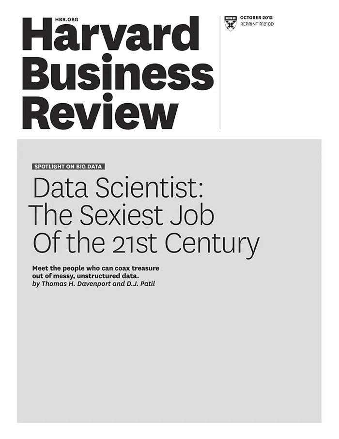{.r-stretch}

::: {.notes}
- "Sexiest job of 21st century"
- Courses online saying need to know - Bayesian modelling, XGBoost, R and Python, SQL optimisation, forecasting, Hadoop, regular expressions... overwhelming
- Made a neurotic list, tried to do lots
:::

## Unrealistic Expectations {.center}

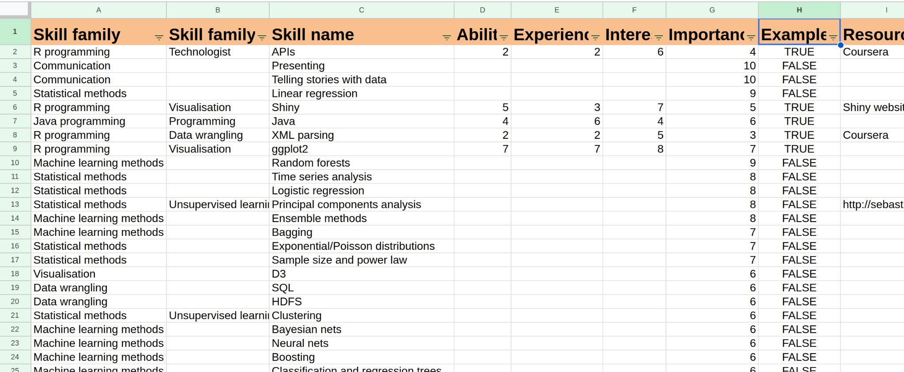{.r-stretch}

::: {.notes}
Here's spreadsheet. Didn't ever fill, gave up and just applied for jobs.
Got one, realised hype, about my capacity to learn and grow while I was doing what I already was doing.
:::

## The Data Science Unicorn {.center}

{.r-stretch}

::: {.notes}
- Lots of criticism at time about people searching for "data science unicorn" - 1 person who has the same skillset as you'd expect a whole team of people to have; unrealistic
:::

## 2026

```{r}
#| label: hype-wordcloud
#| eval: true
#| echo: false
#| cache: true
#| fig-width: 10
#| fig-height: 5
#| fig-align: center
library(ggwordcloud)

hype <- data.frame(
  word = c("agents", "RAG", "vector databases", "prompt engineering", "LLM-as-a-judge",
           "evals", "AI data analyst", "text-to-SQL", "MCP", "embeddings",
           "structured outputs", "fine-tuning", "synthetic data", "tool calling", "vibe coding",
           "agentic workflows", "context engineering", "semantic layer",
           "chat with your data", "LLMOps", "hallucination", "data agents", "harnesses",
           "retrieval", "reranking", "chunking", "knowledge graphs", "GraphRAG",
           "function calling", "few-shot", "chain-of-thought", "reasoning models",
           "guardrails", "red teaming", "prompt injection", "context windows",
           "multimodal", "copilots", "foundation models", "AI code review"),
  weight = c(10, 9, 8, 8, 7, 7, 7, 7, 6, 6, 6, 5, 5, 5, 5, 5, 5, 4, 4, 3, 3, 3, 3,
             4, 3, 3, 3, 3, 4, 3, 3, 4, 3, 2, 3, 3, 3, 3, 3, 3)
)

set.seed(2026)
ggplot(hype, aes(label = word, size = weight, colour = weight)) +
  geom_text_wordcloud(family = "sans", rm_outside = TRUE) +
  scale_size_area(max_size = 15) +
  scale_colour_gradient(low = "#888888", high = "#107895") +
  theme_void()
```

::: {.notes}
- Remind me of ppl talking about AI and AI skills in 2026 - RAG, agents, harnesses, vector databases
- Smells like hype cycle
:::

## AI skill threat

::: {.statement}
Nearly half of developers show signs of AI skill threat - that their their current competencies will become obsolete due to AI
:::

<small>Cat Hicks, [The New Developer: AI Skill Threat, Identity Change & Developer Thriving in the Transition to AI-Assisted Software Development](https://osf.io/preprints/psyarxiv/2gej5_v2)</small>

::: {.notes}
The problem is that this can help us get in our own way - Cat Hicks talks about AI skill threat, the idea that the expectations of our professional identities and skills are changing and feeling like we're going to fail.

It comes from things like thinking about skills as innate and feeling like you have to prove your skills, and we end up feeling inadequate.

It's even more pronounced in women + gender minorities and other minorities.

But we can counter that if we're part of a learning culture, a culture based around the belief we can learn, grow, develop, and take on new skills.
:::

## Centaur

:::: {.columns}

::: {.column width="50%"}
{height="480px"}
:::

::: {.column width="50%"}

::: {.fragment}
Human head and torso, horse body.
:::

::: {.fragment}
Human judgement and thinking, with the speed and strength of the horse.
:::

::: {.fragment}
**An enhanced human.**

e.g. human assisted by AI
:::
:::

::::

::: {.notes}
If we do engage with AI, how do we go about doing this? Idea that AI degrades existing skillsets.

Crisis in universities on assessment - don't have an answer.

Fluency illusion, generating code and understanding it.

Favourite depiction is from Wes M at posit::conf, talks about idea by Cory Doctorow.
:::

## Reverse Centaur

:::: {.columns}

::: {.column width="50%"}
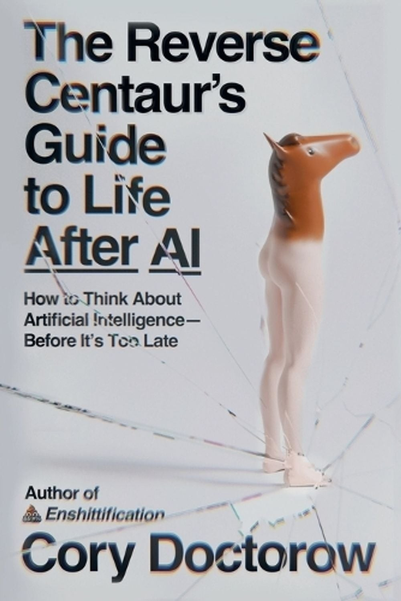{height="480px"}
<small>Cory Doctorow, via Wes McKinney at posit::conf</small>
:::

::: {.column width="50%"}

::: {.fragment}
Horse head, human legs.
:::

::: {.fragment}
Can't really do much.
:::

::: {.fragment}
**The worst of both worlds.**

e.g. AI assisted by human


:::
:::

::::

::: {.notes}
CD is a comp sci writer who talks about the reverse centaur.

Centaur == mythical creature with the head and body of human and back end of horse. Human skills, thinking; horse speed and strength. More than just a human, an enhanced human.

Reverse centaur == head of a horse and legs of person. Useful, can kind of walk around and neigh but the worst of both worlds.

Apply to AI - wanna be centaur, enhanced, not just a crap horse.

Reverse centaur is a human sat there going "yes" without thinking to AI prompts, not thinking or doing anything else or learning anything.
:::

## {.center}

::: {.statement}
how can we use AI so we become more capable, and not dependent?
:::

::: {.notes}
Leads me to question... how can I use AI so I become more capable, and not dependent, but also have some fun when I'm doing it?

So to answer this, I'm going to first talk about using AI for learning, by thinking about what it was like to start working on a new project in R before AI, and then what it was like to get started now that AI is so prevalent, and how I've stopped myself becoming the reverse centaur.
:::

# Learning about code {background-image="images/classroom.png" background-size="cover" background-opacity="0.4"}

::: {.attribution}
"The Rise of the Computerized School", Shigeru Komatsuzaki, 1969
:::

## First open source contribution - 2018

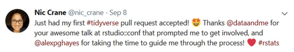{width="620px" fig-align="center"}


::: {.notes}
Now my job but before this, small voluntary contributions.
Made first open source contribution in 2018.
Did bits occasionally after that but the big thing for me was in 2021 when got apprenticeship learning to be an open source maintainer, so someone who has responsibility for reviewing other people's code and the ongoing health of a project

:::

## Arrow - 2021

:::: {.columns}

::: {.column width="40%"}
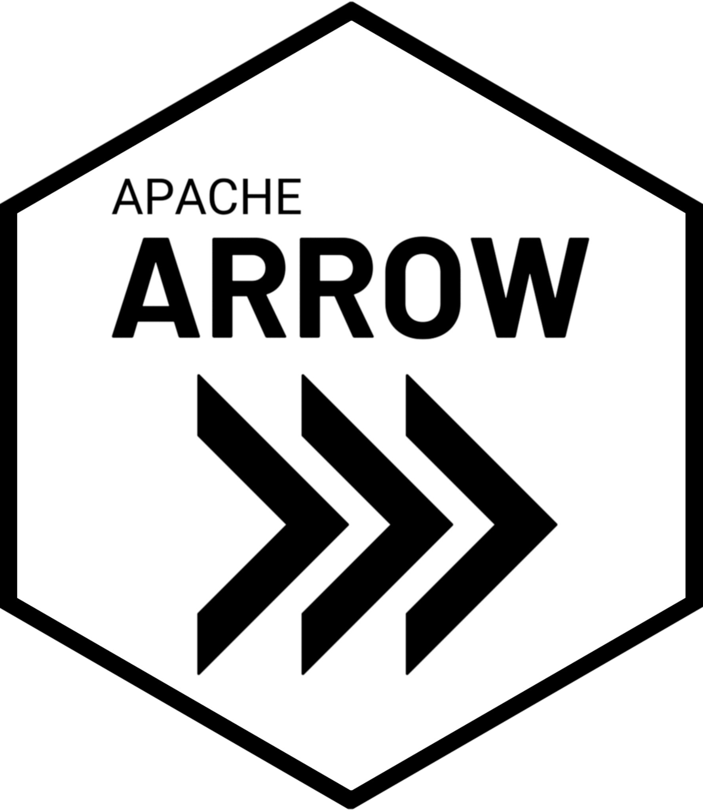{height="380px" fig-align="center"}
:::

::: {.column width="60%"}
Work with large datasets in R

Work with Parquet files
:::

::::

::: {.notes}
- Project was arrow
- What is arrow?
  - R package is for working with larger than memory data in R
  - Working with Parquet format data
- Open source maintainer apprenticeship - path from zero to contributor to maintainer
  - Never seen arrow code before this
  - Huge project, tens of thousands lines of code and lots of languages
  - R package wraps C++; project includes C++ too
- Tremendous amount of effort to get started
:::

## Learning to maintain Arrow

:::: {.columns}

::: {.column width="40%"}

:::

::: {.column width="60%"}
Mentor curated issues for me.

Read code slowly.

Sketched how pieces fit together.

Only possible working full-time.

**Learning by analogy**

:::

::::

::: {.notes}
- Learning by analogy
- My mentor, Jon Keane, spent lots of time curating a list of different issues for me to work on, other issues to read to help me work out how to solve individual ones, and spent lots of time jumping on calls explaining technical details to me of how things worked and giving advice
- High level view
  - Mapping out folders, areas; reading code slowly; sketching diagrams of how pieces fit together

Only doable working full time, sooo much to learn!

Shallow version of this - learning by analogy:

- My first PR was C++ despite never having written a single line of C++ before, still don't
- Many examples like this: it works but I don't know why
- A bit like copying and pasting code from Stack Overflow, which I'm sure lots of us have done here

We say AI helps us generate code but not understand how it works, but we were already able to do this before AI, just less efficiently!

But things have changed a lot since then...
:::

## ellmer - 2026

:::: {.columns}

::: {.column width="40%"}
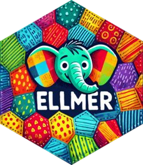{height="380px" fig-align="center"}
:::

::: {.column width="60%"}
Work with LLMs directly from R
:::

::::


## Learning to maintain ellmer

:::: {.columns}

::: {.column width="40%"}
{height="380px" fig-align="center"}
:::

::: {.column width="60%"}


Working more independently

Getting up to speed faster

Working part-time
:::

::::

::: {.notes}
- 2026 - doing some work as a contractor on ellmer
- Package for interacting with LLMs directly from R
- Had written a course on ellmer, found a bug and reported it. Started to fix it but didn't have the time and was complicated and abandoned it.
- When I started working as a maintainer on ellmer, excited to have time to dive into the code properly
- Still social and technical challenges

Complicated codebase!

- Never seen it before
- Working on it part-time
- Bigger jump - from 0 to contributor to maintainer really quickly and much less help!!
  - Contributing code is hard but reviewing other people's code difficult in a different way - answering different questions
- Had AI to help - how I used AI to help
:::

## Learning to maintain ellmer

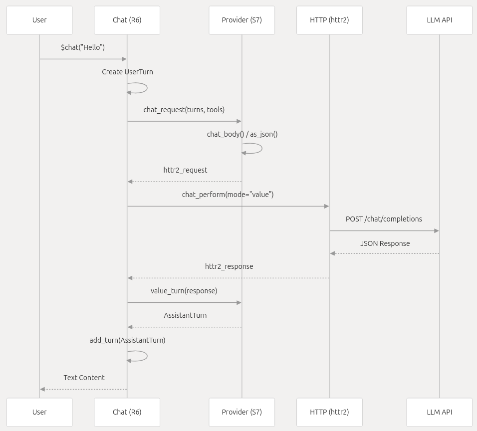{.r-stretch}

<https://deepwiki.com/tidyverse/ellmer>

<!-- DeepWiki sequence diagram of a single chat turn: User -> Chat (R6) ->
Provider (S7) -> HTTP (httr2) -> LLM API and back.
Source: https://deepwiki.com/tidyverse/ellmer (Core Architecture > Chat Object and Lifecycle) -->

::: {.notes}
DeepWiki - instead of having to draw out a diagram myself, AI can do it.

This is one chat turn walking down through the layers and back up: Chat, Provider, httr2, the API.

And it's correct - I checked it against the source. The function names in the labels are the real ones. That's the behaviour I'm recommending: let AI draw the map, then verify it, don't just trust the picture.

Back to learning by analogy, I could ask AI what to read and in what order and summarise design decisions.

Now AI can generate me code, but how can I be confident the code I generate is correct?
:::

## How I write code 

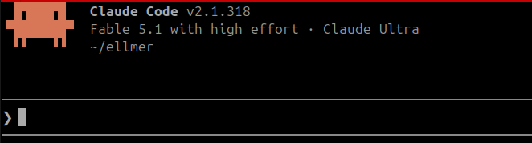{.r-stretch}


## Using `SKILL.md` files

:::: {.columns}

::: {.column width="50%"}
```
---
name: skill-name
description: What this skill does and when to use it
---

# Contents

Instructions in Markdown describing what the agent should do

```
:::

::: {.column width="50%"}

- Define a process or set of rules to use every time
- Adding your own knowledge into the process
:::

::::

::: {.notes}
I use skills.

A skill is a set of instructions and scripts an AI agent can use saved in markdown files - and it loads them when it's doing specific tasks.

They're great because they're reusable - you can write down a process and the agent can follow it every time instead of having to guess.

They're useful because they're a way of injecting your own knowledge into the process.

Effectively, a skill is how you turn your own expertise into something the AI can follow.
:::

## Using skills effectively

- Find existing ones 
- Write your own
- Intervene when an agent gets the same thing wrong repeatedly

<https://github.com/posit-dev/skills>

::: {.notes}
- Include them in your code repos - ellmer has one for writing tests
:::

## {.center}

::: {.statement}
But how can I trust the code that I generate?

::: {.fragment}
**Understand it!**
:::
:::

::: {.notes}
Need to be able to review it via actually knowing the codebase itself.

How to do this in a brand new codebase?

Designed a skill to help me do this.
:::

## Using LLMs for self-directed learning


**Lin, X (2023)**, *Exploring the Role of ChatGPT as a Facilitator for Motivating Self-Directed Learning Among Adult Learners*

::: {.fragment}
- Builds on a **five-step self-directed learning framework** (Kim et al., 2014) that predates AI
:::
::: {.fragment}
- Describes where an LLM can help at each step
:::

::: {.fragment}
Took the process, customised, and turned it into a skill
:::

::: {.notes}
Year before, had read a paper by Xi Lin on how people could use LLMs for learning.

Describes how could apply AI to a framework for self-directed learning - this is separate to AI - framework existed, adding AI on top.

Tried it in August 2025 on a Shiny htmlwidget feature: about an hour, steps 1 to 3. Step 2 (resources) was frustrating, broken links. Step 3 was the best bit - a timeboxed plan, then it guided me with questions rather than answers, and I wrote the code myself.

Made a Claude skill to help walk me through it.
:::

## Rapid learning skill

A skill for quickly learning about code

<https://github.com/thisisnic/rapid-learning>

::: {.notes}
Available at this URL.

Let's look through a concrete example of using it for learning...
:::

## Example: how do tool calls work in ellmer?

Tool: gives the LLM access to information by running R code

:::: {.columns}

::: {.column width="45%" .fragment}
```r
library(ellmer)
chat <- chat_anthropic()
chat$chat("what's the time")
#> Using model = "claude-sonnet-5".
#> I don't have access to real-time
#> information, so I can't tell you
#> the current time.
```
:::

::: {.column width="55%" .fragment}
```{.r code-line-numbers="|5-9|11|13-16"}
library(ellmer)
chat <- chat_anthropic()
#> Using model = "claude-sonnet-5".

time_tool <- tool(
  Sys.time,
  "Get the time",
  name = "time"
)

chat$register_tool(time_tool)

chat$chat("what's the time")
#> ◯ [tool call] time()
#> ● #> "2026-11-12 08:40:46"
#> The current time is **8:40:46 AM**.
```
:::

::::

::: {.notes}
Tools - give LLMs extra functionality they don't have before.

So if I ask for the time...

So how does this actually work, in ellmer's code?

I know from reading the vignette that the LLM isn't calling the R function. But... how does it get called then?

We're going to use the rapid learning skill to find out! I'm going to show you a slightly truncated version of the process.
:::


## 1. Establish Learning Goals

Ask the user, **one question at a time**:

| Question | My answer |
|---|---|
| [What do you want to learn, and why?]{.fragment} | [How tool calling works in ellmer]{.fragment} |
| [Where are you starting from?]{.fragment} | [Written and registered a tool but not looked at the ellmer code before]{.fragment} |
| [How would you like to learn this?]{.fragment} | [Running code]{.fragment} |
| [How much time do you have?]{.fragment} | [10 minutes]{.fragment} |

::: {.notes}
Basically, what did the model ask you and why it mattered.
:::

## 1. Establish Learning Goals

::: {.callout-note appearance="simple" icon=false}
**Primary learning goal:** by the end of 10 minutes, be able to explain what happens during a chat turn, and where a tool call fits in.

**Supporting objective:**

- Compare a turn with and without a tool call and spot the difference
:::

::: {.notes}
Would I have done this if I'd tried learning these things on my own? No!
:::

## 2. Locate and Access Resources

**Outside of the current codebase:** ask questions to figure out what resources are going to be most appropriate

**The current codebase:** don't ask the user anything, find the relevant files yourself

<!-- TODO: fill this in from
https://github.com/thisisnic/rapid-learning/blob/main/SKILL.md#step-2-locate-and-access-resources -->

## 3. Adopt and Execute Learning Activities

- 2-5 hands-on time-boxed activities
- Socratic method - ask the learner questions to help them understand
- Adapt based on responses (if frustrated ask fewer questions!)

::: {.notes}
https://github.com/thisisnic/rapid-learning/blob/main/SKILL.md#step-3-adopt-and-execute-learning-activities

- Socratic method
- Don't forget the stuff you added like getting it to check the time as we go
:::

## 3. Adopt and Execute Learning Activities

::: {.callout-note appearance="simple" icon=false}
**Task: Compare a turn with and without a tool call**

1. Register one simple tool.

2. Ask something that doesn't need it, then something that does.

3. Look at `chat$get_turns()` after each. How many turns did that add?
:::

## 3. Adopt and Execute Learning Activities

Without a tool call...

```{.r code-line-numbers="|1-3|4-7|9-12|13-16"}
library(ellmer)
chat <- chat_anthropic()
#> Using model = "claude-sonnet-5".
chat$chat("Say hi!")
#> Hi there! 👋
#>
#> How are you doing today? I'm happy to help with whatever you need...
chat$get_turns()
#> [[1]]
#> <Turn: user>
#> Say hi!
#>
#> [[2]]
#> <Turn: assistant>
#> Hi there! 👋
#> ...
```

::: {.notes}
User took their turn, then the assistant did - this seems straightforward.
:::

## 3. Adopt and Execute Learning Activities

With a tool call...

```{.r code-line-numbers="|1-2|3-6|7-22"}
time_tool <- tool(Sys.time, "Get the time", name = "time")
chat$register_tool(time_tool)
chat$chat("what's the time")
#> ◯ [tool call] time()
#> ● #> "2026-11-12 08:43:13"
#> The current time is **8:43:13 AM**.
chat$get_turns()
#> [[1]]
#> <Turn: user>
#> what's the time
#>
#> [[2]]
#> <Turn: assistant>
#> [tool request (toolu_01CWL6FhPozDU4LNfraEdcbU)]: time()
#>
#> [[3]]
#> <Turn: user>
#> [tool result (toolu_01CWL6FhPozDU4LNfraEdcbU)]: "2026-11-12 08:43:13"
#>
#> [[4]]
#> <Turn: assistant>
#> The current time is **8:43:13 AM**.
```

::: {.notes}
- Wait a minute, there are more turns here
- [[2]] is an assistant turn - it includes this tool request, a request to use a tool
- But now there's an extra user turn. Now, I, the user didn't ask any other questions, so this must be how ellmer works
- Spoiler - the answer is that ellmer implements these tool calls by running the R function itself, getting the result, and then sending that to the LLM as if the user had sent that information themself.
:::

## 3. Adopt and Execute Learning Activities

With a tool call...

```{.r code-line-numbers="6-12"}
chat$get_turns()
#> [[1]]
#> <Turn: user>
#> what's the time
#>
#> [[2]]
#> <Turn: assistant>
#> [tool request (toolu_01CWL6FhPozDU4LNfraEdcbU)]: time()
#>
#> [[3]]
#> <Turn: user>
#> [tool result (toolu_01CWL6FhPozDU4LNfraEdcbU)]: "2026-11-12 08:43:13"
#>
#> [[4]]
#> <Turn: assistant>
#> The current time is **8:43:13 AM**.
```
::: {.fragment}
💡 ellmer calls the tool's function in the R session and sends the results to the LLM as if the user had sent that message!
:::

::: {.notes}
- So when the LLM responds, it has that information.
- But at this point, I only notice there's an extra user turn, and so the agent keeps asking me questions about what I can see here and what I think it does until we switch over to the code to trace it through, and it all makes sense!
:::

## 4. Monitor and Evaluate Performance

- Checkpoint questions - AI asks to make sure crucial ideas are understood
- Congratulate after each completed activity
- Summarise what learned

## 5. Reassess Learning Strategies

- What worked well and what didn't?
- What was the most valuable thing?
- Did you achieve your goals?

Instructions to feed back into the skill.

::: {.notes}
Don't forget to tie this in to the paper and maybe also Simon Couch's stuff too.

Longer session - work through the code itself, didn't include it here.
:::

## What did this give me?

- Huge reduction in overhead planning learning
- Take on more ambitious tasks
- More confidence in my learning

::: {.notes}
Can it be wrong? Yes, sometimes, but rarely when using latest models. And point is you keep asking questions and look things up yourself.
:::

## {.center}

::: {.statement}
Use AI to customise learning to make it work for you
:::

::: {.notes}
Also Cat Hicks - learning opportunities (read about how it works to mention here!)

Cat Hicks: after you complete significant work (which you can self-define, but I've suggested: creating new files or modules, database schema changes, architectural decisions or refactors, implementing unfamiliar patterns, any work where the user asked "why" questions during development. The key idea is to find a moment in your personal flow where a learning opportunity is most beneficial) Claude will ask: "Would you like to do a quick learning exercise on [topic]? About 10-15 minutes."

So another thing that I learned when I was developing the rapid learning skill was how AI made it really easy to play around with an idea and develop it further into something useful, and that's what I'm gonna talk about next.
:::

# Learning through experimentation {background-image="images/just-imagine-1930-lab.png" background-size="cover" background-opacity="0.4"}

::: {.attribution}
Laboratory set from "Just Imagine", 1930
:::

::: {.notes}
- March 2026
- Company who had funded most of the work on Arrow - Voltron Data - had folded and so fewer paid maintainers, but some of us who were left had managed to get some funding to work on maintaining the project
- Was doing lots of maintenance, but was unsure whether what I was doing was actually useful
:::

## "What can I work on that I can be sure is having an impact?"

::: {.fragment}
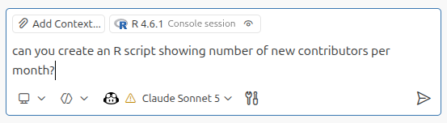{width="700px" fig-align="center"}

<small>March 2026 with Positron Assistant, using Claude Sonnet 4.6 and Claude Opus 4.5</small>
:::

::: {.notes}
- Decided to think about the new contributor experience - how easy is it for people to get started with contributing to arrow and has the new contributor experience got worse since we've had fewer maintainers?
- Experimenting with Positron Assistant to produce a Quarto markdown report with plots that I could add narrative to
- Started by asking "can you create an R script showing number of new contributors per month"
:::

## How has the number of active contributors changed?

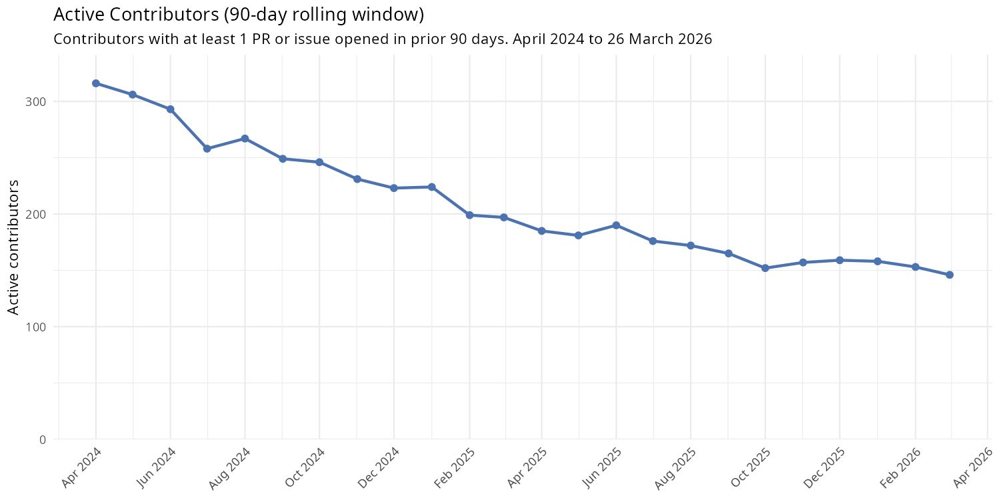{.r-stretch}

::: {.notes}
First question - how have the changes in Voltron Data existing as a company impacted the number of people contributing to Arrow?

Active contributors - people who've opened an issue or a PR in past 90 days.

As expected - declined due to corporate layoffs but then flattened out and stabilised more recently after we got some funding for its maintenance.

Next question then - how many new contributors per month?
:::

## A new metric...

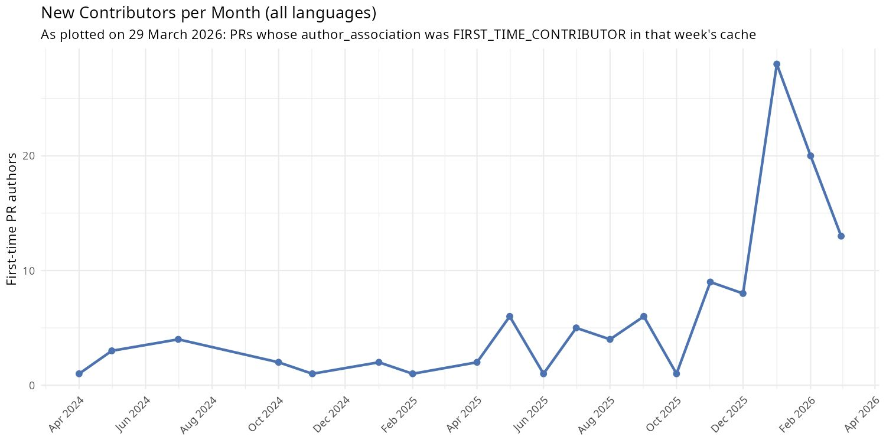{.r-stretch}

::: {.notes}
- A few each month
- Huge spike in January 2026 - likely from AI generated PRs
- But the number of new contributors might not be the best metric... how many were successful, how many got PRs merged?
:::

## Wait... whut?!

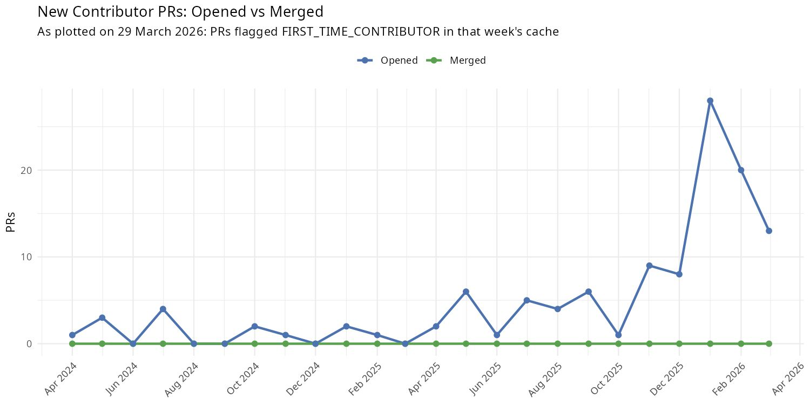{.r-stretch}

::: {.notes}
- And we got this!
- Oh no, we never merge PRs from new contributors :(
- And it gets even worse as I check out the narrative that Claude has added to it
:::

## A poor experience for newcomers?

> "These PRs are sitting entirely unacknowledged, which is both a poor contributor experience and a growing triage burden for maintainers."

> "Some are substantive pieces of work (look at <list of PRs>) that just didn't make it through."

(sad face)

## A poor experience for newcomers? Not quite

> "These PRs are sitting entirely unacknowledged, which is both a poor contributor experience and a growing triage burden for maintainers."

- Me: "don't add judgemental comments about poor contributor experience please, just report the facts."

> "Some are substantive pieces of work (look at <list of PRs>) that just didn't make it through."

- Me: "hmm... how do you know? These were opened within 3 mins of each other..."

::: {.notes}
Scepticism -> think more about the "nothing merged" and then remembered - every time we do a release, we post on social media thanking people!
:::

## A revelation

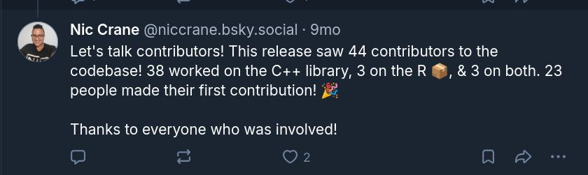{.r-stretch}

::: {.notes}
- Looks like this! So clearly we do have new contributors
- And then I started arguing with AI - told it it was wrong 5 times, and told it to use the script we actually use to generate this list
- Difference - git history vs. GitHub field
- Problem - when we merge things into the project we use a script that can make them appear as closed on GitHub and not merged! So the plot was wrong
- And we decided to make a new one, this time showing the proportions of PRs closed without merging, merged, and never reviewed
:::

## What happens to new contributors' PRs?

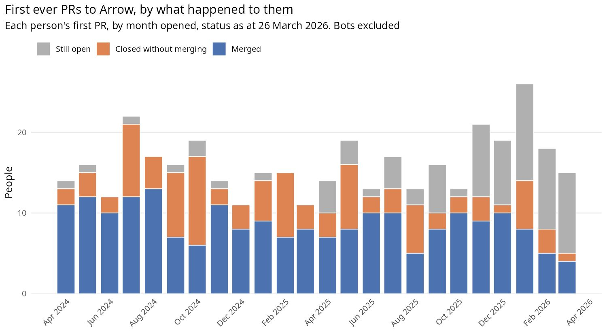{.r-stretch}

::: {.notes}
- Got this! Much more useful!
- Blue - ones which did get merged, so looks reasonable
- Orange - closed without merging - sometimes the author gives up, sometimes the issue turns out to be something else
- Grey - hadn't been reviewed yet
  - Higher proportions more recently, that makes sense - maintainers working through the backlog
  - But... wanted to know more and dig deeper into this!
:::

## New categorisation scheme

::: {.incremental}
- "There was a comment in the past 2 weeks"
  - New category: "active"
- "Last comment was from maintainer over 2 months ago with no response from author"
  - New category: "abandoned"
- "Last comment by the author over a month ago, still waiting for a maintainer reply"
  - New category: "stale-risk"
:::

::: {.notes}
Ended up with a series of classifications...
:::

## Back to my original question

### What can I work on that I can be sure is having an impact?

::: {.incremental}
- Find stale PRs and either:
  - answer the question myself
  - ping the maintainers for an answer
- Find abandoned PRs and either
  - finish them off
  - close them
:::

::: {.notes}
- Ended up with concrete outcomes here
- Questions shifted from "how can I help new contributors" to "how can I help the project get more issues resolved"
:::

## What I learned

::: {.incremental}
- Wrong answers were still useful
- Fast iteration made me realise I was asking the wrong question
- Domain knowledge and scepticism did the hard work
:::

::: {.notes}
- Even wrong answers were useful
  - Even though the analyses were crap/misleading, I learned a lot by arguing with AI, verifying and checking things, and expanding on it when it was correct
    - None of the earlier plots made it into the final report but they helped me work out what to ask
  - I had a dashboard showing new contributions and I updated it to use the new definition of new contributor (i.e. the human-generated one was wrong too, the AI made the same mistakes!)
  - I learned a lot about our data from doing this!
- Being able to generate plots so quickly made it possible to figure out I'd been asking the wrong question all along
  - Shifted from "how can we help new contributors" to "how can we help get code merged into the project and reduce maintainer burden"
- Understanding the domain not the data was crucial for figuring out what was wrong and why. Manually checking the results was essential. Extreme scepticism was essential - treat outputs as hypotheses not answers.
- It took ages! Experimentation isn't efficient but you learn a lot. As a human I might have decided the metrics and then built them, but this allowed me to try a huge mix of things.
- Experimentation taught me the right question to ask but my expertise told me which answers to trust
:::

## {.center}

::: {.statement}
Use AI to run experiments cheaply and learn about your reality
:::

# Adapting how you work {background-image="images/robot-and-woman-control-console.png" background-size="cover" background-opacity="0.4"}

::: {.attribution}
Alex Schomburg, cover for "The Exile of Time", Avalon Books, 1964
:::

::: {.notes}
- Last piece of puzzle is about thinking about how we work with AI so you don't end up fighting it or getting overwhelmed
- Those plots I shared before that showed a small blip in the new contributors?
:::

## 

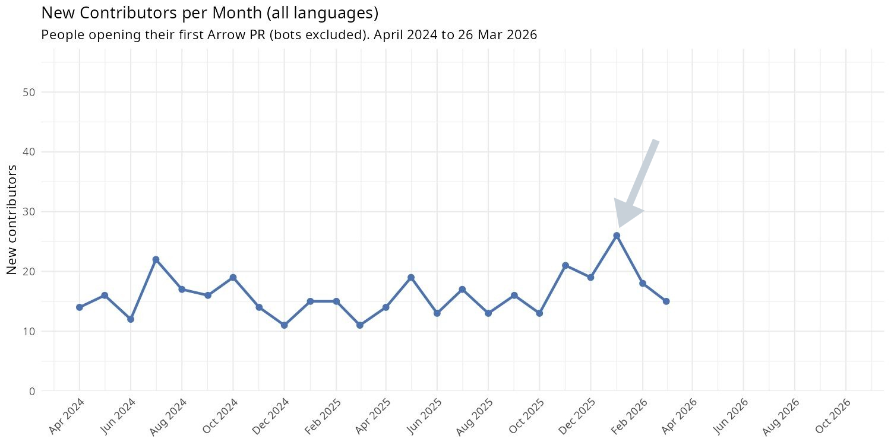{.r-stretch}

::: {.notes}
- This one was generated in March 2026, bigger scale on the y axis. Steady decline, flattening at the end.
- Small blip in January. Let me tell you about January.
:::

## Arrow in January 2026

::: {.incremental}
- Loads of new code contributions
- Way too many tests
- Never interact much
:::

::: {.notes}
- Started noticing a pattern in PRs
- Contributor wanted to contribute, used AI, didn't engage with the output before submitting
- Not judging - my first PRs were for the achievement not the codebase, and I've made my own embarrassing AI mistakes (Claude pushed to upstream instead of my fork)
- So I took it to the mailing list. Nervous - lots of negativity online about AI, and I use it myself
- Community engaged thoughtfully, Andrew Lamb pointed me at DataFusion's existing guidelines, agreed a set in a week
:::

## Arrow's AI guidelines

::: {.incremental}
- "Only submit a PR if you can debug and own the changes yourself"

- "Be upfront about AI usage"
:::

::: {.notes}
- Merged end of January. Other projects linked to it.
- Blog post. Relief. We've got this.
- And then the PRs went quiet through spring.
:::

## The effect

::: {.incremental}
- nobody paid attention
- frustrating experience reviewing code
- arguing with other maintainers
:::


::: {.notes}

:::

## Automatic AI code review

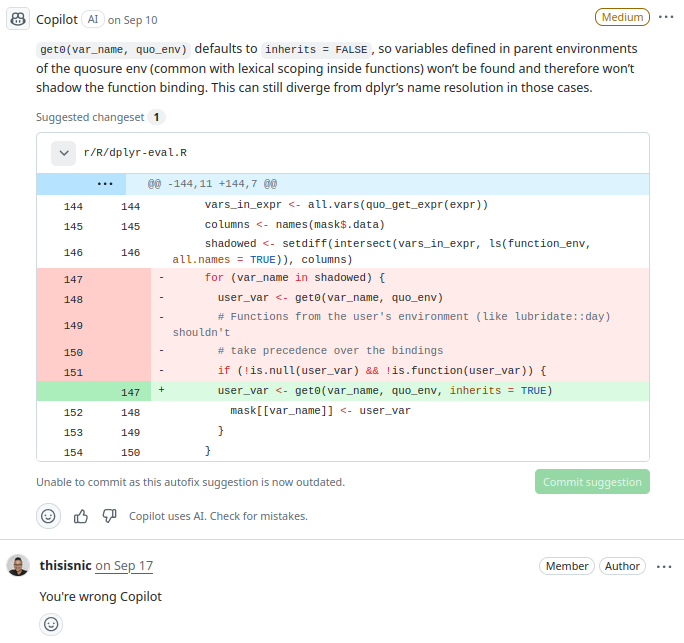{.r-stretch}


::: {.notes}
- Turned on Copilot auto-review. A machine to do the first look so we don't have to.
- Wrong often enough that you end up reviewing the reviewer. Now there's the PR and the bot's opinion of the PR, and I'm cleaning up both.
- Problem was though the sheer volume of people
:::

## Not so bad, right?

{.r-stretch}


## Things had changed more than we thought

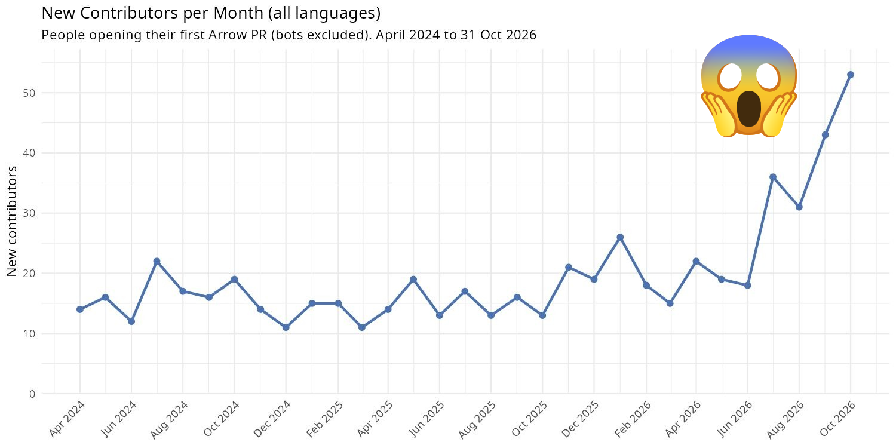{.r-stretch}

::: {.notes}

- Reran the analysis a couple of weeks ago. Oh. That's why.
- PRs from accounts with nothing merged: about 7 a month in 2025. 106 in October. Over half of everything opened that month. None merged.
- Models got good enough, people realised they can contribute with agents, and they are.
- It's a mix. Genuine: people who never thought they could contribute, now can. Less good: code dumped that the author doesn't understand, review feedback goes straight back into the AI, nobody learned anything.
:::

## Trying to keep up

::: {.incremental}
- all the caffeine!
- just need to try harder
:::

::: {.notes}
- Went to see if there was anything I could learn by analogy
:::


## How do air traffic controllers maintain concentration?

{.r-stretch}

::: {.notes}
- First instinct: how do people whose whole job is sustained concentration do it?
- Mandatory breaks every 1.5 to 2 hours, minimum rest between shifts, standard ways of communicating.
- But hold up, this is crazy!
- So I tried it. Reviewing in the morning, other work in the afternoon. Little bits at a time.
:::

## Decision fatigue

{.r-stretch}

::: {.notes}
- Decision fatigue
- So there I am, a maintainer of an open source project, researching how to optimise my shirts so I can review more pull requests nobody read before sending.
- That's the reverse centaur. Rearranging myself to keep up with AI machine's pace.
:::

## Rethinking my approach

{.r-stretch}

::: {.notes}
- Spent a lot of time on Bluesky seeing how other maintainers were dealing with this. Mostly: complaining. Same as me.
- Then this. Hadley: no one is forcing you to read it.
- Made me stop. I'd been treating the volume as the problem. The problem was what I thought I owed.
:::

## {.center}

::: {.statement}
"How does \<prominent maintainer\> say no?"
:::

::: {.incremental}
- Thank them
- Explain why
- Move on
:::

::: {.notes}
- Still felt guilty saying no. A PR is someone's effort. My instinct is to welcome them.
- So I did the section 2 thing on my own problem. Got AI to read closed tidyverse PRs: how do Hadley and Jenny say no?
- Answer: thank them, explain why. But mostly: treat a PR as a proposal, not a gift.
- A friend saying "gig tonight?", not a distant relative's Christmas sweater, three sizes too big and not your colour. You can say no to a proposal without being rude.
:::

## A PR is a proposal, not a gift

:::: {.columns}

::: {.column width="50%" .fragment}
**A proposal**

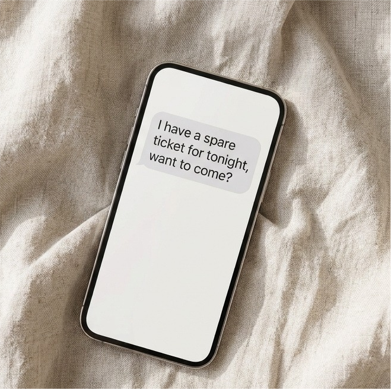{height="340px" fig-align="center"}
:::

::: {.column width="50%" .fragment}
**Not a gift**

{width="100%"}
:::

::::

::: {.notes}
- A proposal: a friend saying "gig tonight?". You can say no without being rude, and they'll ask again another time.
- A gift: the distant relative's Christmas jumper, three sizes too big and not your colour. You feel obliged to wear it.
- Treating PRs as gifts is what made saying no feel so bad.
:::

## The actual solution

Set boundaries!

::: {.notes}

- With myself first. Too tired to think: tea, walk. Intentionally slow down on some tasks. Stopped trying to go faster.
- With others. AI wall of text: I don't read it. Ask for a summary, or "can you explain this in your own words?" No proof of life, no review.
- Engage with the humans more, the output less.
:::

## What does setting good boundaries look like?

**You are allowed to say "no" without long justifications**

- I'm not going to read a 300-line AI-written PR description

## What does setting good boundaries look like?

**Focus on your own actions, not theirs**

- I can't stop people submitting AI-generated pull requests, but I choose which ones get my time

## What does setting good boundaries look like?

**"If X then Y"**

```r
if(human_involved){
  engage()
} else {
  close_pr()
}
```

- If there are signs a human is engaged, I'll review their code
- If not, I close it without one

## AI Reviews

::: {.incremental}
- Copilot reviews the PR, I clean up after it 👎
- AI drafts a review locally, I read it, own it, and act on it 👍
:::

::: {.notes}
- AI isn't completely out of the picture.
- Copilot auto-review: machine reviews, I adjudicate its mistakes. Reverse centaur.
- A first pass that I read and own: machine drafts, I decide. Centaur. It got me there faster, but the review is mine.
- Teaching it to review meant writing down my own process. I had to decide what good looks like. My non-AI reviews got better too.
- Generated code: walk me through a chunk at a time, not everything at once.
:::

## {.center}

::: {.statement}
Work differently, not harder
:::

## Learning throughout history

:::: {.columns}

::: {.column width="30%"}
{height="380px" fig-align="center"}
:::

::: {.column width="25%"}
{height="380px" fig-align="center"}
:::

::: {.column width="45%"}
{width="100%"}
:::

::::

::: {.notes}
Said at the start this felt like 2016 again. It goes back further.

- 370BC - Socrates complained that writing would make people bad at learning
- 1970s - Calculators - teachers saying would make us bad at maths
- 1990s - Internet becoming mainstream, fears that people would be bad at researching topics at libraries and would just copy and paste instead

- Every time: same fear. The tool will do the thinking and the skill will wither.
- Every time, partly right. Some skills did atrophy.
- And partly wrong. The baseline of what you could build or learn moved up.
- Which side of that line you land on isn't decided by the tool. It's decided by how you use it.
:::

## Thank you! {.center}

<!-- TODO: add a generated background image later, e.g.
## Thank you! {.center background-image="images/..." background-opacity="0.4"} -->

www.niccrane.com

https://github.com/thisisnic

https://bsky.app/profile/niccrane.bsky.social
